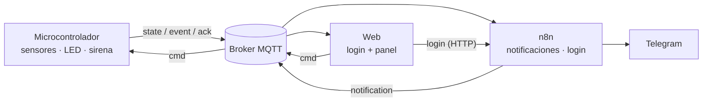

# Smart Home

Sistema inteligente de automatización y seguridad para el hogar. Monitorea la casa de forma autónoma
(puertas, ventanas, movimiento y humo) y avisa al usuario en tiempo real cuando hay una situación de riesgo.

Proyecto en equipo de la materia **Programación en Tiempo Real**. Este repositorio contiene la **web**:
el login y el panel desde donde el usuario ve y controla el sistema.

## Cómo funciona

El sistema tiene cuatro estados:

| Estado | Qué pasa | LED | Sirena | Luces |
|---|---|---|---|---|
| **Desarmado** | No vigila aperturas ni movimiento. El humo se vigila siempre. | apagado | silenciada | apagadas |
| **Armado** | Vigila puertas, ventanas y movimiento. Al armar hay un tiempo de salida (30 s) para salir de la casa. | azul fijo | silenciada | apagadas |
| **Intervención** | Hubo una detección estando armado. Cuenta regresiva (15 s) para desarmar. | ámbar intermitente | pitido de aviso | apagadas |
| **Alarma** | Intrusión confirmada o humo. Se notifica al usuario por Telegram. | rojo intermitente | sonando (se puede silenciar) | encendidas |

- El **humo dispara la alarma siempre**, aunque el sistema esté desarmado.
- Si hay humo e intrusión a la vez, se muestran como **varios riesgos simultáneos**.

## Arquitectura



| Parte | Responsable | Qué hace |
|---|---|---|
| **Microcontrolador** | hardware | Lee los sensores, maneja LED, sirena y luces, y es la **fuente de verdad** del estado: la máquina de estados y las cuentas regresivas corren ahí. |
| **n8n** | backend | Valida el login (webhooks), envía la notificación por Telegram en cada alarma y publica el resultado. |
| **Web** | este repo | Muestra el estado en tiempo real y envía comandos (armar, desarmar, silenciar). Nunca decide el estado por su cuenta. |
| **Contrato** | todos | Formato JSON de los mensajes entre las tres partes: [`docs/contrato.md`](docs/contrato.md). |

La conexión entre el micro y el resto (MQTT o HTTP) **todavía no está definida**: depende del
microcontrolador. Por eso la web accede al dispositivo a través de una capa de transporte intercambiable,
y mientras tanto usa un **mock**: un dispositivo virtual que corre en el navegador y habla exactamente el
mismo contrato.

### El contrato

[`docs/contrato.md`](docs/contrato.md) define los tópicos, los mensajes (`state`, `event`, `cmd`, `ack`), las reglas
de comportamiento que tiene que respetar el micro y los permisos del broker. Los ejemplos JSON del documento se
validan automáticamente en los tests, así que el documento no puede quedar desactualizado respecto del código.

`src/core/alarm-machine.js` es la máquina de estados en JavaScript: la usa el mock y sirve de **especificación
ejecutable** para el firmware (`tests/alarm-machine.test.js` tiene un test por regla).

## Correrlo localmente

Requiere [Node.js](https://nodejs.org/) 22.12 o superior (lo pide Vitest; está declarado en `engines` de
`package.json`). El archivo `.nvmrc` fija la versión que usa el proyecto (y la que usa el deploy): con
[nvm](https://github.com/nvm-sh/nvm) alcanza con `nvm use` (en Windows, con nvm-windows: `nvm use 24`).

```bash
npm install
npm run dev
```

Abrí la dirección que muestra Vite (por defecto http://localhost:5173).

| Comando | Qué hace |
|---|---|
| `npm run dev` | Servidor de desarrollo con recarga automática. Login en `/`, panel en `/panel.html`. |
| `npm test` | Corre los tests (Vitest). |
| `npm run build` | Genera la versión estática en `dist/`. |
| `npm run preview` | Sirve `dist/` para probar el build. |

### Configuración

No hace falta configurar nada para usar el modo demo. Para cambiar algo, copiá `.env.example` a `.env`
(está en `.gitignore`, no se sube):

| Variable | Valores | Por defecto |
|---|---|---|
| `VITE_TRANSPORT` | `mock` (por ahora el único implementado) | `mock` |
| `VITE_AUTH` | `mock` o `http` (webhooks de n8n) | `mock` |
| `VITE_MOCK_EMAIL` / `VITE_MOCK_PASSWORD` | credenciales del login de prueba | ver abajo |
| `VITE_N8N_URL` | base de los webhooks de n8n | — |
| `VITE_DEVICE_ID` | id del dispositivo | `casa-01` |
| `VITE_DEMO` | `true` para mostrar la simulación con hardware real | `false` |

> **Las variables `VITE_*` no son secretas.** Vite las copia dentro del JavaScript que descarga el
> navegador, así que cualquiera puede leerlas. No pongas ahí nada que no pueda ser público.

## Modo demo

Con el mock (la configuración por defecto) la web funciona sin hardware ni backend:

- **Login de prueba:** `demo@smarthome.local` / `smarthome`. La pantalla de login lo muestra en modo demo.
- **Simular** en cada sensor lo activa o lo restablece. **Simular todo a la vez** arma el sistema si hace falta y
  activa los cinco sensores, para ver humo e intrusión juntos.
- **Reiniciar demo** vuelve todo a desarmado, con los sensores en reposo y el historial limpio.
- Las notificaciones se muestran como **«Notificación simulada»**: no se envía ningún Telegram.
- El estado se guarda en el navegador y sobrevive a una recarga. Con varias pestañas abiertas, todas ven
  el mismo dispositivo.

## Estructura

```
├─ index.html, panel.html     páginas (login y panel)
├─ docs/contrato.md           contrato de mensajes para hardware y n8n
├─ src/
│  ├─ core/                   máquina de estados, contrato, cliente del dispositivo, config
│  ├─ transport/              transportes (hoy: mock)
│  ├─ auth/                   login (mock o n8n) y sesión
│  ├─ login/, panel/          lógica de cada pantalla
│  └─ styles/                 tokens de diseño y estilos
├─ tests/                     tests con Vitest
└─ Start Home.html            diseño de referencia (login y panel)
```

## Estado actual

| Paso | Estado |
|---|---|
| 1. Base del proyecto y login | ✅ |
| 2. Máquina de estados y contrato de mensajes | ✅ (borrador, a confirmar con el equipo) |
| 3. Panel de control con el mock | ✅ |
| 4. Conexión real con el micro (MQTT o HTTP) | ⏸️ en espera hasta confirmar el microcontrolador y su conectividad |

Pendiente de confirmar con hardware: el tiempo de salida y qué pasa al armar con una puerta o ventana abierta
(ver «A confirmar con hardware» en el contrato).
